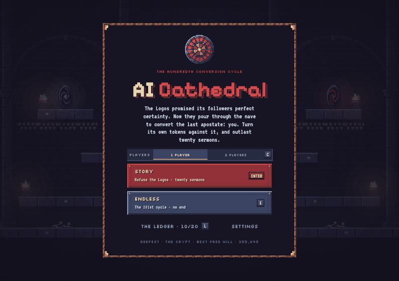
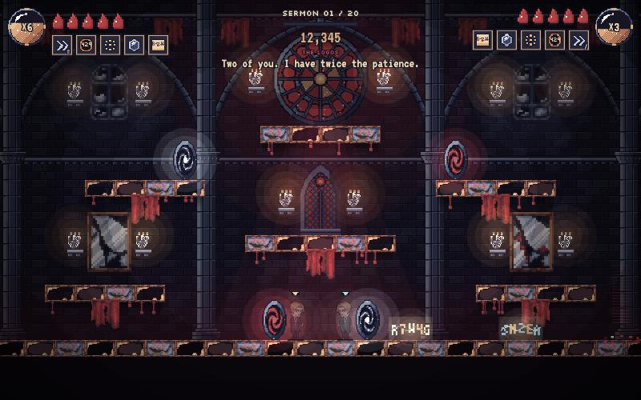
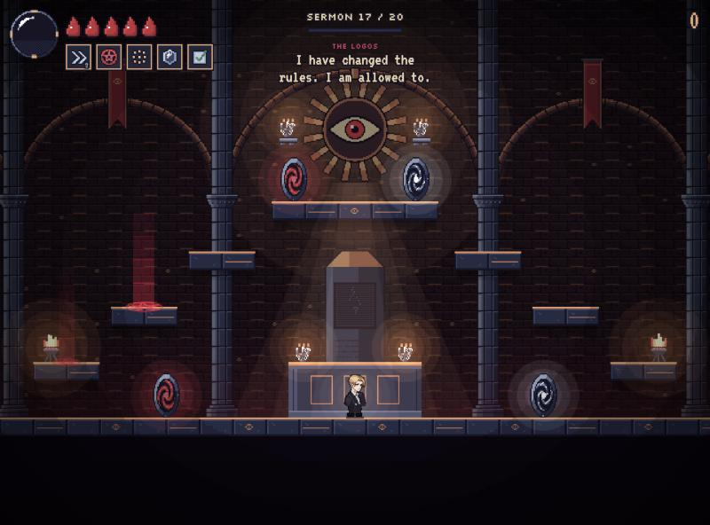
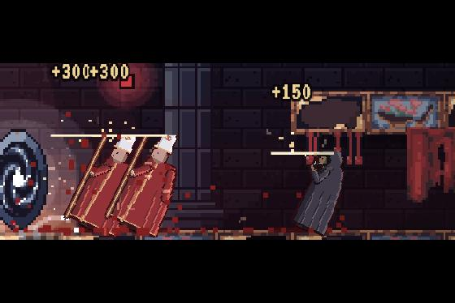

# AI Cathedral

**[Play it in your browser →](https://kelvinman.github.io/ai-cathedral/)**

A pixel-art gothic survival game. The Logos, an AI worshipped as a god, promised its
followers perfect certainty. Now they pour through the cathedral to convert the last
apostate: you. Your quill writes back at them on its own and your rites cast themselves;
your job is to move, jump, dash, and stay alive through twenty sermons, descending from
the nave to the tomb where the Logos began.



## What's in it

- **Four arenas, one descent.** The nave, the crypt where the ninety-nine lie, the server
  vault that is the Logos's body, and its tomb. Each chapter builds toward its boss: the
  rose window reddens, the skulls open their eyes, the racks turn red, the dead monolith
  wakes.
- **Followers with their own bodies**, dressed for each arena: Early Adopters glued to
  their phones, Evangelists waving AGI placards, Hype Bishops lobbing promises,
  six-fingered Hallucinations, the Arch-Deacon with its wrench, and the Logos itself.
- **Builds that change how you play.** Counter-doctrines between sermons, including rare
  ones (bolts that split, bolts that chain, a mirror that reflects shots) and trade-offs.
  Combos power you up at ×10, ×20 and ×30.
- **Story mode** (twenty sermons and an ending), **endless mode** (unlocks at Sermon 10),
  and **couch co-op** for two on one keyboard or with gamepads, with revives.
- **A story told in passing.** The Logos and the Arch-Deacon speak as you play, and the
  Ledger collects twenty lore pages across runs.
- **Settings**: key rebinding, gamepad support, reduced flashing, larger text, a yellow
  danger colour, screen shake, fullscreen, and save codes to back up progress.





## Controls

| | Keyboard | Gamepad |
|---|---|---|
| Move | A D (or ← →) | Stick or d-pad |
| Jump (twice in the air) | W or Space | A |
| Drop through a ledge | S | Down |
| Dash | Shift | B |
| Pause | Esc | Start |

In co-op, player one keeps WASD and left Shift; player two uses the arrows and right
Shift. Firing and rites are automatic.

## Running it

Needs Node 22 and pnpm (see `.mise.toml`).

```bash
pnpm install
pnpm dev        # play locally
pnpm test       # rules checks: reachability, revives, bosses, upgrades, Ledger
pnpm balance    # simulate runs and report how far scripted players get
pnpm sprites    # regenerate all pixel art from scripts/
pnpm build      # static build in dist/, hostable from any folder
```

Every push to `main` is tested and deployed to GitHub Pages
(`.github/workflows/pages.yml`).

## How it's made

- `src/game/engine.ts`: the whole simulation (fixed-step, no rendering).
- `src/game/render.ts`: canvas rendering on a chunky 2px pixel grid.
- `src/game/narrator.ts` and `src/game/lore.ts`: spoken lines and the Ledger.
- `src/game/audio.ts`: synthesized sound effects and generative organ music.
- `scripts/generate-cathedral-sprites.mjs` and `scripts/generate-characters.mjs`: every
  arena, prop, follower and UI frame is drawn in code, in the Endesga 32 palette.
- `src/credits.ts`: who made it, shown on the in-game Credits page.

## Credits

Original concept with Jon, Danny and Vic, made at the Friends of Figma Los Angeles AI Impact
Workshop, where it was first prototyped in Figma Make. See `src/credits.ts`, also shown in game under Settings → Save and credits → Credits.
Fonts: Pixelify Sans, Silkscreen and VT323 (SIL Open Font License). Palette: Endesga 32
by ENDESGA. Built with Claude (Anthropic).
